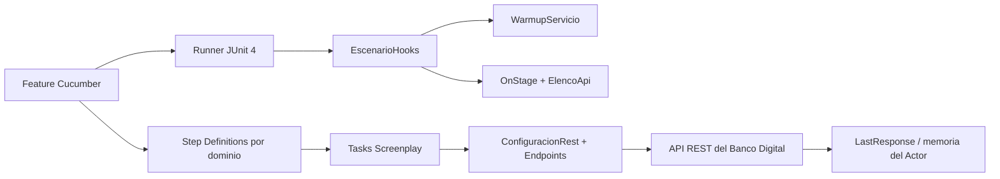

# BancoDigital Automation — EAP07

Automatización de la API REST del Banco Digital para la Fábrica Escuela CodeFactory 2026-2, Universidad de Antioquia.

- Equipo: EAP07.
- Repositorio: [EAP07-Banco-Digital/eap07-banco-digital-automation](https://github.com/EAP07-Banco-Digital/eap07-banco-digital-automation).
- Backend de referencia: `https://eap07-banco-digital-backend.onrender.com`.
- Base de datos del sistema bajo prueba: PostgreSQL en Neon.
- Alcance: API REST, sin frontend.
- Ejecución soportada actualmente: local; no existe configuración de GitHub Actions o CI en este repositorio.

> Este documento refleja el código inspeccionado localmente. Cuando una definición pertenece al backlog o a una revisión previa de Swagger y no está representada en el repositorio, se marca como pendiente de contraste.

## Índice

1. [Contexto, alcance y estado actual](#1-contexto-alcance-y-estado-actual)
2. [Stack tecnológico e instalación](#2-stack-tecnológico-e-instalación)
3. [Configuración del entorno](#3-configuración-del-entorno)
4. [Arquitectura del proyecto](#4-arquitectura-del-proyecto)
5. [Componentes reutilizables existentes](#5-componentes-reutilizables-existentes)
6. [Convenciones obligatorias](#6-convenciones-obligatorias)
7. [Catálogo de contratos REST](#7-catálogo-de-contratos-rest)
8. [Distribución definitiva del trabajo](#8-distribución-definitiva-del-trabajo)
9. [Guía para implementar una nueva HU](#9-guía-para-implementar-una-nueva-hu)
10. [Render, seguridad, ejecución, Git y defectos](#10-render-seguridad-ejecución-git-y-defectos)
11. [Instrucciones para agentes de IA, troubleshooting y checklist](#11-instrucciones-para-agentes-de-ia-troubleshooting-y-checklist)

---

## 1. Contexto, alcance y estado actual

El proyecto pertenece al curso de Ingeniería de Sistemas de la UdeA y automatiza flujos del Banco Digital mediante Serenity BDD, Screenplay REST, Cucumber y REST Assured.

### Métricas de planificación

La planificación entregada al equipo contempla:

| Métrica | Valor | Interpretación |
|---|---:|---|
| HUs seleccionadas | 14 | Alcance de trabajo del backlog: HU1, HU2, HU8, HU4, HU7, HU9, HU5, HU6, HU11, HU14, HU12, HU15, HU17 y HU18. |
| Escenarios funcionales objetivo | 22 | Conteo objetivo después de combinar los dos escenarios originales de HU8 en uno. |
| Escenarios originales representados | 23 | 22 objetivo + 1 escenario absorbido por la combinación de HU8. |
| Escenarios del backlog completo | 57 | Incluye escenarios excluidos del alcance actual; no están aprobados ni ejecutados en este repositorio. |

### Estado comprobado en el repositorio

El árbol local contiene actualmente:

- 5 escenarios funcionales implementados: HU1 (2), HU2 (2) y HU8 (1).
- 17 escenarios funcionales pendientes del plan.
- 17 pruebas técnicas: 15 pruebas JUnit y 2 escenarios Cucumber técnicos.
- 5 Tasks compartidas: `RegistrarUsuario`, `IniciarSesion`, `AbrirCuenta`, `FondearCuenta` y `CerrarSesion`.
- `AbrirCuenta` y `FondearCuenta`: validadas técnicamente con servidor local simulado; su validación funcional contra el backend real queda pendiente en sus HUs.
- HU1, HU2 y HU8: cuentan con runners individuales y un `Runner` general.

El estado anterior no implica que las 14 HUs estén implementadas. En particular, no existen todavía features, step definitions ni runners para HU4, HU5, HU6, HU7, HU9, HU11, HU12, HU14, HU15, HU17 y HU18.

### Flujo general



---

## 2. Stack tecnológico e instalación

### Versiones declaradas

Las versiones siguientes fueron contrastadas en `build.gradle` y el Gradle Wrapper:

| Componente | Versión/configuración |
|---|---|
| Java | Toolchain `21` |
| Gradle | Wrapper `9.5.1` |
| Serenity BDD | `5.4.2` |
| Cucumber | Dependencia transitiva de Serenity; API JUnit/Cucumber usada por el código |
| JUnit | `4.13.2` |
| REST Assured | Disponible transitivamente mediante `serenity-screenplay-rest` |
| Serenity Screenplay REST | `5.4.2` |
| Screenplay Architecture | Plugin `io.github.jumosqu12.screenplayarchitecture` `2.0.1` |
| SLF4J Simple | `2.0.16` |
| Hamcrest | `hamcrest-all` `1.3` para pruebas |
| Apache Commons DBCP2 | `2.13.0` |

El plugin Screenplay Architecture se publica en [jumosqu12/ScreenplayArchitecture](https://github.com/jumosqu12/ScreenplayArchitecture). `settings.gradle` configura `mavenLocal()` y `gradlePluginPortal()`. La resolución de `ScreenplayArchitecture 2.0.1` desde una máquina completamente limpia todavía no ha sido comprobada; esto no implica un defecto de instalación. No se debe usar una ruta personal ni modificar el build para ocultar un problema de resolución.

### Requisitos previos

1. Instalar un JDK 21.
2. Verificar que `java -version` muestre Java 21.
3. Configurar `JAVA_HOME` apuntando al JDK, no al directorio del JRE.
4. Clonar el repositorio y abrirlo desde su raíz.
5. Usar el Wrapper incluido; no instalar ni fijar otra versión de Gradle.

Windows PowerShell:

```powershell
java -version
$env:JAVA_HOME
.\gradlew.bat --version
```

Linux/macOS:

```bash
java -version
echo "$JAVA_HOME"
./gradlew --version
```

En el IDE se debe importar el proyecto como Gradle, seleccionar el JDK 21 para Gradle y conservar el Wrapper. No se debe añadir `org.gradle.java.home` con una ruta local al repositorio.

### Advertencias conocidas

La compilación muestra advertencias de APIs deprecated en `CucumberOptions`, `CucumberWithSerenity` y `SerenityRunner`. Son advertencias del stack actual; no se recomienda migrar runners ni actualizar versiones como parte de una HU funcional.

---

## 3. Configuración del entorno

La fuente central es `co.edu.udea.eap07.certificacion.bancodigital.config.ConfiguracionEntorno`. Es inmutable y resuelve variables de entorno en cada llamada a `desdeEntorno()`.

### Variables y valores reales

| Variable | Default real | Uso | Comportamiento |
|---|---|---|---|
| `BASE_URL` | `https://eap07-banco-digital-backend.onrender.com` | Base de todas las llamadas | Opcional; acepta HTTP/HTTPS con host, sin credenciales, query ni fragmento; elimina barras finales. |
| `HTTP_CONNECT_TIMEOUT_MS` | `15000` | Conexión REST | Entero positivo; valor explícito inválido produce error. |
| `HTTP_READ_TIMEOUT_MS` | `30000` | Lectura REST | Entero positivo; valor explícito inválido produce error. |
| `WARMUP_MAX_ATTEMPTS` | `5` | Intentos de warmup | Entero positivo. |
| `WARMUP_RETRY_DELAY_MS` | `15000` | Espera entre reintentos de warmup | Entero positivo. |
| `WARMUP_READ_TIMEOUT_MS` | `120000` | Timeout de lectura del warmup | Entero positivo. |
| `ADMIN_EMAIL` | Sin default | Operaciones administrativas | Solo se exige al llamar `adminEmail()`; necesaria únicamente para Persona 3. |
| `ADMIN_PASSWORD` | Sin default | Operaciones administrativas | Solo se exige al llamar `adminPassword()`; necesaria únicamente para Persona 3. |

Las credenciales administrativas no son necesarias para HU1, HU2, HU8 ni para las Tasks de cuentas existentes. Son un canal privado: nunca deben versionarse, imprimirse ni incluirse en un modelo de prueba compartido.

### PowerShell: variables de la sesión actual

Usar valores reales solo en la sesión local y no escribirlos en archivos:

```powershell
$env:BASE_URL = 'https://eap07-banco-digital-backend.onrender.com'
$env:HTTP_CONNECT_TIMEOUT_MS = '15000'
$env:HTTP_READ_TIMEOUT_MS = '30000'
$env:WARMUP_MAX_ATTEMPTS = '5'
$env:WARMUP_RETRY_DELAY_MS = '15000'
$env:WARMUP_READ_TIMEOUT_MS = '120000'
$env:ADMIN_EMAIL = Read-Host 'ADMIN_EMAIL'
$secure = Read-Host 'ADMIN_PASSWORD' -AsSecureString
$ptr = [Runtime.InteropServices.Marshal]::SecureStringToBSTR($secure)
try {
    $env:ADMIN_PASSWORD = [Runtime.InteropServices.Marshal]::PtrToStringBSTR($ptr)
} finally {
    [Runtime.InteropServices.Marshal]::ZeroFreeBSTR($ptr)
}

if ([string]::IsNullOrWhiteSpace($env:ADMIN_EMAIL) -or
    [string]::IsNullOrWhiteSpace($env:ADMIN_PASSWORD)) {
    throw 'Faltan credenciales administrativas'
}
```

La comprobación anterior valida presencia sin imprimir valores. Para limpiar la sesión:

```powershell
'BASE_URL','HTTP_CONNECT_TIMEOUT_MS','HTTP_READ_TIMEOUT_MS',
'WARMUP_MAX_ATTEMPTS','WARMUP_RETRY_DELAY_MS','WARMUP_READ_TIMEOUT_MS',
'ADMIN_EMAIL','ADMIN_PASSWORD' |
    ForEach-Object { Remove-Item "Env:$($_)" -ErrorAction SilentlyContinue }
```

### Windows persistente

`setx` deja los valores en futuras sesiones y puede quedar registrado en el historial o en herramientas del sistema. Usarlo solo con placeholders y nunca con secretos reales en documentación:

```powershell
setx BASE_URL "<BASE_URL_HTTP_O_HTTPS>"
setx ADMIN_EMAIL "<ADMIN_EMAIL>"
setx ADMIN_PASSWORD "<ADMIN_PASSWORD>"
```

Después de `setx` se debe abrir una nueva terminal. Para eliminar una variable persistente, usar la herramienta de configuración del sistema o establecerla vacía según la política local; verificar siempre en una nueva sesión sin imprimir el valor.

### Bash: variables de la sesión actual

```bash
export BASE_URL="https://eap07-banco-digital-backend.onrender.com"
export HTTP_CONNECT_TIMEOUT_MS=15000
export HTTP_READ_TIMEOUT_MS=30000
export WARMUP_MAX_ATTEMPTS=5
export WARMUP_RETRY_DELAY_MS=15000
export WARMUP_READ_TIMEOUT_MS=120000
read -r -p "ADMIN_EMAIL: " ADMIN_EMAIL
read -r -s -p "ADMIN_PASSWORD: " ADMIN_PASSWORD
echo
export ADMIN_EMAIL ADMIN_PASSWORD
test -n "$ADMIN_EMAIL" && test -n "$ADMIN_PASSWORD"
```

Limpiar:

```bash
unset BASE_URL HTTP_CONNECT_TIMEOUT_MS HTTP_READ_TIMEOUT_MS
unset WARMUP_MAX_ATTEMPTS WARMUP_RETRY_DELAY_MS WARMUP_READ_TIMEOUT_MS
unset ADMIN_EMAIL ADMIN_PASSWORD
```

Para un backend local se puede usar un placeholder, por ejemplo `http://127.0.0.1:<PUERTO>`. No se debe agregar una URL alternativa fija al código.

---

## 4. Arquitectura del proyecto

### Paquete base

`co.edu.udea.eap07.certificacion.bancodigital`

La estructura real actual es híbrida: capas Screenplay y subdominios funcionales.

```text
src/
├── main/java/co/edu/udea/eap07/certificacion/bancodigital/
│   ├── config/
│   │   ├── ConfiguracionEntorno.java
│   │   └── ConfiguracionRest.java
│   ├── integrations/
│   │   ├── ElencoApi.java
│   │   └── WarmupServicio.java
│   ├── models/
│   │   ├── autenticacion/
│   │   └── cuentas/
│   ├── tasks/
│   │   ├── autenticacion/
│   │   └── cuentas/
│   └── utils/
│       ├── datos/
│       ├── ClavesMemoria.java
│       ├── DatosDePrueba.java
│       └── Endpoints.java
└── test/
    ├── java/co/edu/udea/eap07/certificacion/bancodigital/
    │   ├── hooks/EscenarioHooks.java
    │   ├── runners/
    │   ├── stepdefinitions/autenticacion/
    │   └── technical/
    └── resources/
        ├── features/autenticacion/
        ├── technical-features/
        └── serenity.conf
```

### Paquetes reales y paquetes futuros

| Paquete | Responsabilidad | Estado |
|---|---|---|
| `config` | Entorno, timeouts, configuración REST y lista negra de `Authorization` | Existente |
| `integrations` | Cast API y warmup | Existente |
| `models` | Solicitudes inmutables serializables | Existente en `autenticacion` y `cuentas`; otros dominios futuros |
| `tasks` | Operaciones Screenplay reutilizables | Existente en `autenticacion` y `cuentas` |
| `questions` | Consultas Screenplay reutilizables | No existe actualmente; crear solo con responsabilidad clara |
| `interactions` | Interacciones técnicas reutilizables | No existe actualmente |
| `utils` | Endpoints, memoria y datos sintéticos | Existente |
| `hooks` | Ciclo de vida Cucumber | Existente en tests |
| `stepdefinitions` | Glue por dominio funcional | Existente únicamente para autenticación |
| `runners` | Suites funcionales y técnicas | Existente |
| `technical` | Pruebas de arquitectura y regresión transversal | Existente |
| `features` | Lenguaje de negocio funcional | HU1, HU2 y HU8 existentes |
| `technical-features` | Features de integración técnica | Existente para hooks |

La organización conceptual prevista para futuros dominios es: `autenticacion` (HU1, HU2, HU8), `perfil` (HU4, HU7), `administracion` (HU9), `cuentas` (HU5, HU6, HU11, HU14), `transferencias` (HU12, HU15) y `topes` (HU17, HU18). Los paquetes que no aparecen en el árbol real todavía no deben documentarse como implementados.

### Ciclo de vida de un escenario

1. Cucumber selecciona una feature mediante un runner JUnit 4.
2. `EscenarioHooks.@Before` resuelve `ConfiguracionEntorno`, ejecuta el warmup y configura `OnStage` con `ElencoApi`.
3. El primer `Given` crea explícitamente el actor.
4. Las Step Definitions encadenan Tasks y capturan `LastResponse` antes de una nueva petición.
5. `@After` dibuja la cortina y termina el escenario.

---

## 5. Componentes reutilizables existentes

### 5.1 Tasks compartidas

| Task | Firma real | Método HTTP y endpoint | Memoria |
|---|---|---|---|
| `RegistrarUsuario` | `RegistrarUsuario.conDatos(SolicitudRegistro solicitud)` | `POST /api/usuarios/registro` | No guarda respuesta ni credenciales. |
| `IniciarSesion` | `IniciarSesion.conCredenciales(SolicitudInicioSesion solicitud)` | `POST /api/auth/login` | Elimina `jwt` antes de evaluar la respuesta; guarda un token no vacío solo en HTTP 200. |
| `AbrirCuenta` | `AbrirCuenta.conDatos(SolicitudAperturaCuenta solicitud)` | `POST /api/v1/cuentas` | Usa JWT si existe; en HTTP 201 guarda `numeroCuenta` y `clienteId` si están presentes. Una apertura fallida conserva la última cuenta exitosa. |
| `FondearCuenta` | `FondearCuenta.en(String numeroCuenta, SolicitudDeposito solicitud)` | `POST /api/v1/cuentas/{numeroCuenta}/depositos` | Usa la cuenta recibida explícitamente; no modifica memoria. |
| `CerrarSesion` | `CerrarSesion.actual()` | `POST /api/auth/logout` | Elimina `jwt` solo en HTTP 200; un fallo conserva el token. |

Todas usan interacciones REST nativas de Serenity y `withNoReporting()`. Las Tasks no contienen aserciones funcionales, no crean actores, no registran usuarios, no autentican automáticamente y no reintentan operaciones bancarias.

#### Ejemplo 1: registrar y autenticar un cliente

```java
SolicitudRegistro registro = DatosRegistro.solicitudValida();
cliente.attemptsTo(RegistrarUsuario.conDatos(registro));
assertThat(cliente.asksFor(LastResponse.received()).statusCode(), equalTo(201));

cliente.attemptsTo(IniciarSesion.conCredenciales(
        new SolicitudInicioSesion(registro.getEmail(), registro.getPassword())));
assertThat(cliente.asksFor(LastResponse.received()).statusCode(), equalTo(200));
assertThat(cliente.recall(ClavesMemoria.JWT) != null, equalTo(true));
```

Capturar y validar `LastResponse` inmediatamente. No mostrar el password ni el JWT en una aserción.

#### Ejemplo 2: abrir una cuenta autenticado

```java
cliente.attemptsTo(AbrirCuenta.conDatos(
        new SolicitudAperturaCuenta("AHORROS")));
Response respuesta = cliente.asksFor(LastResponse.received());
assertThat(respuesta.statusCode(), equalTo(201));
String numeroCuenta = cliente.recall(ClavesMemoria.NUMERO_CUENTA);
```

El backend y el backlog son la fuente para los tipos válidos; el modelo deliberadamente no normaliza ni valida `tipoCuenta`.

#### Ejemplo 3: abrir y fondear una cuenta

```java
cliente.attemptsTo(AbrirCuenta.conDatos(
        new SolicitudAperturaCuenta("AHORROS")));
Response apertura = cliente.asksFor(LastResponse.received());
assertThat(apertura.statusCode(), equalTo(201));
String cuenta = cliente.recall(ClavesMemoria.NUMERO_CUENTA);

cliente.attemptsTo(FondearCuenta.en(
        cuenta, new SolicitudDeposito(new BigDecimal("100000.00"))));
assertThat(cliente.asksFor(LastResponse.received()).statusCode(), equalTo(201));
```

`FondearCuenta.en` recibe la cuenta explícitamente y serializa `monto` como número `BigDecimal`; no agrega `numeroCuenta` al body.

#### Ejemplo 4: preparar dos clientes independientes

```java
Actor actor1 = OnStage.theActorCalled("ClienteA");
// Registrar y validar HTTP 201 para actor1.
assertThat(actor1.asksFor(LastResponse.received()).statusCode(), equalTo(201));
// Autenticar y validar HTTP 200 para actor1 antes de alternar.
assertThat(actor1.asksFor(LastResponse.received()).statusCode(), equalTo(200));

Actor actor2 = OnStage.theActorCalled("ClienteB");
// Registrar con DatosRegistro.solicitudValida() independiente para actor2.
assertThat(actor2.asksFor(LastResponse.received()).statusCode(), equalTo(201));
// Capturar/validar la respuesta de actor2 antes de cualquier nueva petición.
```

En Step Definitions funcionales, `actor1` y `actor2` deben declararse como atributos privados de instancia e inicializarse una sola vez por escenario mediante `OnStage.theActorCalled(...)`. No usar actores estáticos ni asumir que la memoria de `actor1` pertenece a `actor2`. `LastResponse` no está aislada por actor: una petición de otro actor sobrescribe el contexto REST compartido del hilo, por lo que cada respuesta debe validarse o capturarse antes de alternar.

#### Ejemplo 5: autenticar un administrador

```java
ConfiguracionEntorno entorno = ConfiguracionEntorno.desdeEntorno();
SolicitudInicioSesion credencialesAdmin = new SolicitudInicioSesion(
        entorno.adminEmail(), entorno.adminPassword());
administrador.attemptsTo(IniciarSesion.conCredenciales(credencialesAdmin));
Response respuesta = administrador.asksFor(LastResponse.received());
assertThat(respuesta.statusCode(), equalTo(200));
```

Este ejemplo solo muestra el uso de las credenciales bajo demanda. No hay una Task administrativa específica implementada ni deben agregarse secretos a `DatosRegistro`.

### 5.2 Configuración REST

`ConfiguracionRest` expone:

- `publica(ConfiguracionEntorno)`: request público sin body JSON.
- `publicaJson(ConfiguracionEntorno)`: request público con `Content-Type: application/json`.
- `conToken(ConfiguracionEntorno, String)`: agrega `Authorization: Bearer ...` si el token no es `null`.
- `conTokenJson(ConfiguracionEntorno, String)`: token y body JSON.
- `aplicar(RequestSpecification, ConfiguracionEntorno, String, boolean)`: aplica timeouts, `Accept`, body JSON opcional y autorización.
- `configuracionHTTP(ConfiguracionEntorno)`: conecta los timeouts y oculta `Authorization` en logging REST Assured.

Si el token es `null`, la request se envía sin `Authorization`; un token vacío explícito produce error. La Task debe decidir si la ausencia de token es un caso negativo válido.

### 5.3 Rutas y memoria

`Endpoints` es la fuente centralizada de rutas. Entre las rutas ya declaradas están `REGISTRO`, `LOGIN`, `LOGOUT`, `USUARIO_ACTUAL`, `CUENTAS`, `DEPOSITOS`, `SALDO_CUENTA`, `TRANSFERENCIAS` y endpoints administrativos.

`ClavesMemoria` contiene `JWT`, `TOKEN_REVOCADO`, `USUARIO_ID`, `ROL`, `CLIENTE_ID`, `CUENTA_ID` y `NUMERO_CUENTA`. No usar literales alternativos para esas claves.

### 5.4 Datos, elenco y warmup

- `DatosDePrueba` genera identificadores, correos `@example.com` y documentos sintéticos únicos.
- `DatosRegistro.solicitudValida()` construye una solicitud de registro sintética.
- `SolicitudRegistro` protege el password en `toString()`.
- `SolicitudInicioSesion` protege el password en `toString()`.
- `ElencoApi` asigna `CallAnApi` con la `baseUrl` resuelta.
- `WarmupServicio` usa `GET /v3/api-docs`, reintenta solo el warmup para errores transitorios 5xx o de conexión y conserva la interrupción del hilo.
- El estado de warmup está indexado por base URL normalizada y ruta; destinos distintos son independientes y un destino exitoso se calienta una vez por JVM.
- `EscenarioHooks` ejecuta warmup antes de preparar el escenario y elimina el stage después.

---

## 6. Convenciones obligatorias

### Actores

Cada Step Definition debe declarar un atributo de instancia:

```java
private Actor cliente;
```

Inicializarlo una sola vez en el primer `Given`, después del hook:

```java
this.cliente = OnStage.theActorCalled("Cliente");
```

Usar el mismo atributo en todos los pasos. No usar:

- `new Actor(...)` en Step Definitions, Tasks o Questions.
- Actores estáticos o singletons.
- `OnStage.theActorInTheSpotlight()` como sustituto repetido del atributo.
- Creación de actores dentro de Tasks.

Los nombres académicos usados hasta ahora son `Visitante`, `Cliente` y, para futuras HUs, `Administrador`.

### Tasks, Questions, Interactions y modelos

- Las Tasks ejecutan acciones y no contienen aserciones funcionales.
- Crear una Question solo si encapsula una consulta reutilizable y concreta; no crear clases vacías.
- Usar `LastResponse.received()` y validar la respuesta antes de ejecutar otra petición.
- No guardar respuestas de negocio, saldos o tokens innecesariamente en memoria.
- Usar `BigDecimal` para dinero; nunca `double` o `float`.
- Mantener modelos inmutables y `toString()` sin passwords, JWT ni secretos.
- Usar `withNoReporting()` en requests con credenciales, tokens o cuerpos sensibles.

### Gherkin y nombres

- Features y pasos en inglés.
- Clases, métodos y paquetes Java en español cuando representan dominio.
- Mensajes del backend en español, exactamente como el contrato los publica.
- Nombre recomendado: `huXX_nombre_funcional_en_ingles.feature`.
- Tags de planificación: `@huXX`, `@critical`, `@e2e`; HU18 debe usar obligatoriamente `@serial`.
- No introducir endpoints, JSON, códigos HTTP ni datos concretos en lenguaje de negocio.

En el caso HU8, el paso quedó desambiguado como `I should see the sign-out confirmation message {string}` para no colisionar con el paso de éxito de HU1. Una nueva HU debe buscar expresiones únicas antes de crear glue adicional.

### LastResponse y actores

`LastResponse` representa el contexto REST actual y no está aislada por actor. Una petición posterior, incluso de otro actor, sobrescribe el contexto compartido del hilo. Capturarlo inmediatamente después de cada Task o interacción; si se necesitan dos respuestas, guardar la primera en una variable local o en un atributo de escenario sin almacenar secretos.

---

## 7. Catálogo de contratos REST

La fuente oficial para contratos es `https://eap07-banco-digital-backend.onrender.com/v3/api-docs`. La tabla separa el endpoint principal de cada HU de sus endpoints auxiliares y distingue lo validado de lo que todavía debe contrastarse con Swagger y backlog.

| HU | Método y endpoint principal | Estado y alcance contractual |
| :--- | :--- | :--- |
| **HU1** | `POST /api/usuarios/registro` | Implementado y ejecutado satisfactoriamente contra el backend desplegado. HTTP 201 para registro; HTTP 409 con `EMAIL_ALREADY_REGISTERED` para duplicidad. La propiedad del mensaje es `message`. |
| **HU2** | `POST /api/auth/login` | Implementado y ejecutado satisfactoriamente contra el backend desplegado. HTTP 200 con token; los escenarios de credenciales inválidas y bloqueo se respaldan en el contrato documentado previamente. |
| **HU8** | `POST /api/auth/logout` | Implementado y ejecutado satisfactoriamente contra el backend desplegado. HTTP 200 con `message = "Sesion cerrada correctamente"`; el mismo JWT revocado debe producir `TOKEN_REVOKED`, no simplemente `UNAUTHORIZED`. `GET /api/usuarios/me` es auxiliar para probar acceso antes y después del logout. |
| **HU4** | `GET /api/usuarios/me` | Endpoint principal; campos, códigos y mensajes funcionales pendientes de contraste. |
| **HU7** | `PUT /api/usuarios/me` | Endpoint principal; request, respuesta y validaciones pendientes de contraste. `GET /api/usuarios/me` puede ser auxiliar para verificar la actualización. |
| **HU9** | `PUT /api/usuarios/{id}/rol` | Endpoint principal; usuario desechable, permisos, request, respuesta y errores pendientes de contraste. |
| **HU5** | `POST /api/v1/cuentas` | Endpoint principal; apertura existe como Task compartida, pero escenario y contrato completo están pendientes. |
| **HU6** | `GET /api/v1/cuentas/{numeroCuenta}/saldo` | Endpoint principal; escenarios, campos y reglas pendientes de contraste. |
| **HU11** | `GET /api/v1/cuentas` | Endpoint principal; contrato y escenarios pendientes de contraste. |
| **HU14** | `POST /api/v1/cuentas/{numeroCuenta}/depositos` y `POST /api/v1/cuentas/{numeroCuenta}/retiros` | Endpoints principales; request, respuestas y errores pendientes de contraste. |
| **HU12** | `POST /api/v1/transferencias` | Endpoint principal; límites, request, respuestas y escenarios pendientes de contraste. Las consultas de saldo/topes son auxiliares de precondición o verificación. |
| **HU15** | `GET /api/v1/cuentas/{numeroCuenta}/transacciones` | Endpoint principal; filtros, campos y contrato funcional pendientes de contraste. |
| **HU17** | `GET /api/v1/transferencias/topes` | Endpoint principal; contrato y escenarios pendientes de contraste. |
| **HU18** | `GET /api/v1/admin/transferencias/topes` y `PUT /api/v1/admin/transferencias/topes` | Endpoints principales; modificación, restauración, serialización y concurrencia pendientes de contraste. `@serial` es obligatorio. |

### Errores transversales

`UNAUTHORIZED` y `FORBIDDEN` aparecen como categorías de seguridad del backlog y como respuestas esperadas en tareas previas. Cada nueva HU debe confirmar código, `errorCode`, `message`, `details` y `traceId` en Swagger; no asumir que dos endpoints comparten el mismo cuerpo.

Regla crítica de autenticación: `TOKEN_REVOKED` es un hallazgo distinto de `UNAUTHORIZED`. HU8 verifica específicamente la revocación del mismo JWT después de logout.

Reglas críticas de futuras HUs:

- HU9: usar un usuario desechable y evitar cambiar datos permanentes del equipo.
- HU18: restaurar obligatoriamente el estado modificado y marcar el escenario `@serial`; la ejecución serial es obligatoria para esta HU.
- Ninguna HU debe acceder directamente a Neon desde la automatización.

---

## 8. Distribución definitiva del trabajo

La distribución siguiente corresponde al plan de 14 HUs y 22 escenarios objetivo (23 escenarios originales porque HU8 combina dos), no a clases ya presentes en el repositorio.

| Responsable | Dominio funcional | Historias de usuario | Escenarios | Estado |
| :--- | :--- | :--- | :---: | :--- |
| **Camilo (Persona 1)** | Identidad y autenticación | HU1 (2), HU2 (2), HU8 (1) + config, arquitectura, Tasks compartidas, docs y PRs | 5 | Implementados |
| **Persona 2** | Gestión del perfil | HU4 (2: perfil auth / sin auth), HU7 (1: actualizar contacto) | 3 | Pendientes |
| **Persona 3** | Administración y políticas bancarias | HU9 (2: admin cambia rol / cliente sin permiso), HU17 (1: consultar topes), HU18 (1: configurar topes) | 4 | Pendientes |
| **Persona 4** | Gestión de cuentas bancarias | HU5 (2: apertura ok / duplicada), HU6 (1: saldo), HU11 (1: listar cuentas), HU14 (2: depósito / retiro) | 6 | Pendientes |
| **Persona 5** | Transferencias e historial | HU12 (3: transferencia ok / saldo insuf. / cuenta ajena), HU15 (1: historial sin filtros) | 4 | Pendientes |

La asignación por persona no altera la organización técnica de paquetes Java: `autenticacion` (HU1, HU2, HU8), `perfil` (HU4, HU7), `administracion` (HU9), `cuentas` (HU5, HU6, HU11, HU14), `transferencias` (HU12, HU15) y `topes` (HU17, HU18) siguen separados.

### Justificación por dominio

- **Persona 2 — Perfil:** HU4 y HU7 operan sobre `/api/usuarios/me`, comparten modelos/consultas y verifican la actualización mediante una lectura posterior.
- **Persona 3 — Administración y topes:** centraliza los permisos administrativos de HU9 y las políticas de transferencia de HU17/HU18, limitando el uso de credenciales admin a un solo integrante.
- **Persona 4 — Cuentas:** HU5, HU6, HU11 y HU14 giran en torno al ciclo de vida de la cuenta bancaria: apertura, consulta, saldo, depósitos y retiros.
- **Persona 5 — Transferencias e historial:** HU12 genera movimientos que luego se verifican en el historial de HU15.

### Independencia entre integrantes y matriz de reutilización

Todos pueden trabajar en paralelo desde `main`, sin esperar ramas ajenas ni invocar Step Definitions de otros escenarios. La dependencia funcional del sistema (por ejemplo, una transferencia requiere cuentas existentes) no implica dependencia de implementación de pruebas: cada integrante prepara sus propios datos y reutiliza Tasks compartidas.

| Componente | Persona 2 | Persona 3 | Persona 4 | Persona 5 |
| :--- | :---: | :---: | :---: | :---: |
| `RegistrarUsuario` | Sí | Sí | Sí | Sí |
| `IniciarSesion` | Sí | Sí | Sí | Sí |
| `AbrirCuenta` | No requerido | No requerido | Sí | Sí |
| `FondearCuenta` | No requerido | No requerido | Según escenario | Sí |
| `CerrarSesion` | Disponible | Disponible | Disponible | Disponible |
| Credenciales admin | No | Sí | No | No |

Persona 5 evita bloqueos entre historias así:

- **HU12 frente a HU5/HU14:** usa directamente `AbrirCuenta` y `FondearCuenta` ya existentes.
- **HU12 frente a HU6:** consulta `/api/v1/cuentas/{numeroCuenta}/saldo` con interacciones REST nativas de Serenity y mantiene auxiliares propios dentro de `transferencias`, sin tocar `cuentas`.
- **HU12 frente a HU17:** consulta los topes vigentes directamente como precondición, sin hardcodear límites ni esperar HU17.
- **HU15 frente a HU14:** genera movimientos con `FondearCuenta` o sus propias transferencias, sin esperar los escenarios funcionales de depósitos/retiros.

Para cada escenario pendiente, la precondición y la validación clave deben copiarse del backlog aprobado y contrastarse con `/v3/api-docs`; no se deben inventar cuerpos ni mensajes.

### Protocolo operativo especial de HU18 (`@serial`)

Persona 3 debe cumplir este protocolo antes de ejecutar HU18:

1. Coordinar una ventana de ejecución exclusiva con el equipo. `@serial` no impone exclusión mutua automática entre procesos/personas; las ejecuciones generales deben excluir `@serial`.
2. Consultar y respaldar los topes originales y verificar que exista una configuración inicial recuperable. Si no existe, no modificar el estado global sin autorización.
3. Actualizar los topes, validar respuesta/estado y garantizar la restauración mediante `try/finally` (o equivalente), incluso si falla una aserción; nunca depender de un paso final Gherkin tras un fallo.
4. Verificar que la restauración fue exitosa y alertar al equipo de inmediato si falla, sin ocultar errores ni tocar Neon directamente.

---

## 9. Guía para implementar una nueva HU

Procedimiento recomendado en 18 pasos:

1. Identificar la HU y sus escenarios aprobados en el backlog.
2. Confirmar el reparto de trabajo y la rama base.
3. Inspeccionar solo las firmas necesarias de configuración, Tasks y memoria existentes.
4. Consultar `/v3/api-docs` para el endpoint, request y respuestas.
5. Registrar discrepancias entre Swagger, backlog y backend como defectos; no maquillar expectativas.
6. Determinar las precondiciones y datos sintéticos independientes.
7. Confirmar si existe una Task reutilizable antes de crear otra.
8. Crear o ampliar el modelo inmutable solo con las propiedades del contrato.
9. Usar `BigDecimal` para importes.
10. Crear la Task en el subdominio correcto, sin aserciones ni reintentos de negocio.
11. Reutilizar `Endpoints`, `ConfiguracionRest` y `ClavesMemoria`.
12. Proteger cuerpos y headers con `withNoReporting()`.
13. Crear el feature en inglés, sin detalles técnicos.
14. Crear Step Definitions con actor explícito de instancia.
15. Capturar y validar `LastResponse` antes de la siguiente petición.
16. Crear un runner individual con feature exclusiva y glue apropiado.
17. Validar primero con servidor local simulado; después decidir si procede una ejecución controlada contra Render.
18. Ejecutar compilación, pruebas, reportes, búsqueda de secretos, `git diff --check`, revisión y PR.

### Independencia de datos

Cada escenario debe generar sus propios datos con `DatosDePrueba` o una fábrica de dominio. No depender de que otro integrante haya creado un usuario, cuenta o transferencia en Neon. Para clientes, el patrón existente es:

```java
SolicitudRegistro registro = DatosRegistro.solicitudValida();
cliente.attemptsTo(RegistrarUsuario.conDatos(registro));
assertThat(cliente.asksFor(LastResponse.received()).statusCode(), equalTo(201));
cliente.attemptsTo(IniciarSesion.conCredenciales(
        new SolicitudInicioSesion(registro.getEmail(), registro.getPassword())));
assertThat(cliente.asksFor(LastResponse.received()).statusCode(), equalTo(200));
```

Después se puede encadenar `AbrirCuenta` o `FondearCuenta`, validando cada response. Para HU8, el token original se conserva solo como atributo privado del escenario y se libera al finalizar su comprobación.

---

## 10. Render, seguridad, ejecución, Git y defectos

### Warmup y cold start

`EscenarioHooks` ejecuta el warmup hacia `GET /v3/api-docs` antes del escenario. `WarmupServicio`:

- Usa `HTTP_CONNECT_TIMEOUT_MS` para conexión.
- Usa `WARMUP_READ_TIMEOUT_MS` para lectura.
- Reintenta únicamente errores de conexión y respuestas 5xx.
- No reintenta operaciones bancarias.
- Respeta `WARMUP_MAX_ATTEMPTS` y `WARMUP_RETRY_DELAY_MS`.
- Bloquea concurrentemente solo el destino/ruta que se está calentando.
- Marca el destino como caliente únicamente después de éxito.
- Propaga `Thread.currentThread().interrupt()`.

No agregar `Thread.sleep` a escenarios para resolver cold start.

### Seguridad

- Usar `withNoReporting()` para registro, login, logout y operaciones con JWT o passwords.
- No usar `log().all()` en operaciones sensibles.
- No guardar JWT o passwords en archivos, logs, reportes, mensajes de aserción ni Git.
- No copiar secretos en prompts de agentes de IA.
- No usar credenciales administrativas en pruebas de clientes.
- El blacklist de `Authorization` está configurado en `ConfiguracionRest`.
- La sanitización de bodies depende de no reportar la interacción; cualquier nueva interacción debe conservar esa protección.

### Compilación

PowerShell:

```powershell
.\gradlew.bat compileJava --no-daemon
.\gradlew.bat testClasses --no-daemon
```

Bash:

```bash
./gradlew compileJava --no-daemon
./gradlew testClasses --no-daemon
```

### Runners funcionales

Los comandos siguientes usan el reporte funcional estándar. Para ejecutarlos contra Render se requiere aceptar el cold start y tener las variables adecuadas; este README no los ejecuta automáticamente.

```powershell
.\gradlew.bat test --tests "*RegistroRunner" `
  -PserenityOutputDirectory=target/site/serenity --rerun-tasks --no-daemon

.\gradlew.bat test --tests "*AutenticacionRunner" `
  -PserenityOutputDirectory=target/site/serenity --rerun-tasks --no-daemon

.\gradlew.bat test --tests "*CierreSesionRunner" `
  -PserenityOutputDirectory=target/site/serenity --rerun-tasks --no-daemon

.\gradlew.bat test --tests "*runners.Runner" `
  -PserenityOutputDirectory=target/site/serenity --rerun-tasks --no-daemon
```

La configuración de `test` limpia el directorio seleccionado antes de la ejecución y finaliza con `aggregate`, incluso si una prueba falla. Las validaciones con mock local son recomendables cuando sea posible, pero no sustituyen la ejecución funcional contra el backend desplegado cuando esta haya sido autorizada.

### Pruebas técnicas y reportes

```powershell
.\gradlew.bat test `
  --tests "*ArquitecturaTransversalTest" `
  --tests "*TechnicalRunner" `
  -PserenityOutputDirectory=target/site/serenity-technical `
  --rerun-tasks --no-daemon
```

Abrir reportes:

```powershell
Start-Process (Resolve-Path target/site/serenity/index.html)
Start-Process (Resolve-Path target/site/serenity-technical/index.html)
```

Rutas:

- Funcional: `target/site/serenity/`.
- Técnico: `target/site/serenity-technical/`.

### Dry-run sin HTTP

`Cucumber` lee `CUCUMBER_EXECUTION_DRY_RUN`. Usar una ruta separada y restaurar la variable:

```powershell
$env:BASE_URL = 'http://127.0.0.1:1'
$env:CUCUMBER_EXECUTION_DRY_RUN = 'true'
try {
    .\gradlew.bat test --tests "*runners.Runner" `
      -PserenityOutputDirectory=build/serenity-dryrun `
      --rerun-tasks --no-daemon
} finally {
    Remove-Item Env:BASE_URL,Env:CUCUMBER_EXECUTION_DRY_RUN `
      -ErrorAction SilentlyContinue
}
Remove-Item build/serenity-dryrun -Recurse -Force -ErrorAction SilentlyContinue
```

El dry-run no debe levantar un servidor ni enviar solicitudes. El conteo se debe verificar en los XML de Gradle/Cucumber; Serenity puede no generar outcomes normales para un dry-run.

### Filtrado por tags

`build.gradle` reenvía a la JVM de tests las propiedades `cucumber.filter.tags` y `cucumber.filter.name` cuando se suministran como propiedades del proceso Gradle. Ejemplo:

```powershell
.\gradlew.bat test --tests "*runners.Runner" `
  "-Dcucumber.filter.tags=@hu01" `
  -PserenityOutputDirectory=build/serenity-tag-filter `
  --rerun-tasks --no-daemon
```

El runner general también declara `tags = "not @technical-local"`. El filtro efectivo debe comprobarse en los resultados de la ejecución; no asumir que una expresión de tags del runner se combina con una propiedad externa de forma aditiva.

Para excluir temporalmente `@serial`, el build actual reenvía la propiedad, pero no configura por sí solo una política permanente de exclusión. Cuando los runners y features correspondientes estén implementados, usar y verificar:

```powershell
.\gradlew.bat test --tests "*runners.Runner" `
  "-Dcucumber.filter.tags=not @serial" `
  -PserenityOutputDirectory=build/serenity-no-serial `
  --rerun-tasks --no-daemon
```

La ejecución aislada de HU18 es futura hasta que exista su runner; el patrón previsto es:

```powershell
.\gradlew.bat test --tests "*Hu18Runner" `
  "-Dcucumber.filter.tags=@hu18" `
  -PserenityOutputDirectory=build/serenity-hu18 `
  --rerun-tasks --no-daemon
```

No se debe presentar este último comando como disponible actualmente: `Hu18Runner` aún no existe en el repositorio.

### Aislamiento serial de HU18

El tag `@serial` es obligatorio para HU18 porque modifica una configuración compartida. No impone exclusión mutua automática entre procesos/personas: se debe coordinar una ventana exclusiva, excluir `@serial` de las ejecuciones generales y restaurar el valor anterior en `finally` o hook equivalente. La forma concreta de ejecutar el aislamiento debe verificarse cuando exista el runner de HU18.

### Git y defectos

Flujo recomendado, sujeto a la política del equipo:

1. Crear una rama descriptiva desde la base acordada.
2. Mantener un cambio funcional acotado por HU.
3. Usar commits descriptivos, sin secretos.
4. Ejecutar validaciones y revisar reportes.
5. Abrir PR con evidencia, limitaciones y defectos separados.

No ejecutar `add`, `commit`, `push`, `merge` o cambio de rama como parte de una auditoría o validación automática sin autorización explícita.

Clasificación de defectos:

- Automatización: NPE de actor, glue ambiguo, serialización incorrecta o timeout mal aplicado.
- Backend: respuesta recibida que contradice el contrato/backlog, con evidencia HTTP sanitizada.
- Infraestructura: cold start, indisponibilidad o conectividad, sin afirmar defecto funcional.
- Inconcluso: ausencia de artefactos o contrato suficiente.

No cambiar aserciones para ocultar un defecto real.

---

## 11. Instrucciones para agentes de IA, troubleshooting y checklist

### Reglas para Codex, Claude Code y Copilot

Antes de modificar:

1. Leer la solicitud completa y fijar el alcance exacto.
2. Inspeccionar solo las firmas necesarias.
3. Distinguir código existente, backlog y contrato externo.
4. No inventar endpoints, JSON, credenciales, mensajes ni escenarios.
5. No llamar Render ni Neon sin autorización expresa.
6. No modificar dependencias o infraestructura transversal para resolver una HU.
7. Mantener el actor explícito y la memoria aislada.
8. Usar `withNoReporting()` en operaciones sensibles.
9. Validar con mock local cuando sea posible.
10. Informar discrepancias antes de ampliar componentes existentes.

Prompt inicial reutilizable:

```text
Lee completamente el README.md e inspecciona los componentes existentes del repositorio.
Mi asignación corresponde a la Persona [N].
Identifica exclusivamente las historias de usuario y escenarios que me corresponden según la distribución definitiva.
Antes de implementar, presenta un plan que incluya:
- Historias y escenarios asignados.
- Contratos REST correspondientes.
- Precondiciones de cada escenario.
- Componentes existentes que reutilizarás.
- Archivos que necesitas crear o modificar.
- Validaciones funcionales.
- Estrategia de ejecución y generación de reportes.
Garantiza que mis escenarios puedan desarrollarse y ejecutarse sin depender del trabajo pendiente de otros integrantes.
Respeta todas las convenciones del README. No modifiques componentes ajenos ni infraestructura compartida sin autorización. No inventes contratos de la API, no amplíes el alcance y no expongas credenciales.
No comiences a implementar hasta que apruebe explícitamente el plan.
```

Prompt de revisión final:

```text
Revisa únicamente el diff de la HU. Confirma que no haya endpoints o contratos
inventados, tareas con aserciones, actores nuevos por método, reintentos de
negocio, secretos en artefactos, contaminación de reportes ni cambios fuera
del alcance. Ejecuta solo las validaciones autorizadas y reporta evidencia real.
```

### Troubleshooting

| Síntoma | Diagnóstico y acción |
|---|---|
| JDK incorrecto | Revisar `java -version`, `JAVA_HOME` y `.\gradlew.bat --version`; usar JDK 21. |
| `JAVA_HOME` apunta a una ruta inexistente | Corregir la sesión local; no escribir `org.gradle.java.home` con una ruta personal. |
| Plugin Screenplay Architecture no resuelve | Revisar conectividad a Gradle Plugin Portal/Maven Local y la versión `2.0.1`; no cambiar el plugin sin autorización. |
| Cold start o timeout | Confirmar `BASE_URL`, timeouts y warmup; no agregar sleeps ni reintentos a Tasks bancarias. |
| `BASE_URL` residual | Mostrar solo presencia, limpiar la variable y definir el destino explícito de la sesión. |
| `DuplicateStepDefinitionException` | Buscar expresiones iguales con `rg` y renombrar el paso nuevo; mantener expresiones de dominio únicas. |
| Actor nulo | Verificar que el primer `Given` llame una sola vez a `OnStage.theActorCalled(...)` después del hook. |
| `TOKEN_REVOKED` vs. `UNAUTHORIZED` | Reutilizar el JWT original y comprobar `errorCode`; la ausencia de header no demuestra revocación. |
| `LastResponse` inesperada | Capturar y validar inmediatamente antes de ejecutar otra interacción. |
| Reporte mezcla escenarios | Limpiar el directorio seleccionado y usar `-PserenityOutputDirectory` distinto para funcional/técnico/dry-run. |
| Password o JWT en reporte | Revisar `withNoReporting()`, `LogConfig` y `toString()`; no imprimir el artefacto sensible para diagnosticar. |
| HTTP 409/403 no esperado | Sanitizar status, `errorCode`, `message` y `traceId`; contrastar con Swagger/backlog y registrar defecto si corresponde. |

### Checklist por integrante

- [ ] La HU y sus escenarios están aprobados en el backlog.
- [ ] El contrato fue contrastado con Swagger o la discrepancia está documentada.
- [ ] La rama parte de la base correcta.
- [ ] No se modificaron dependencias ni infraestructura sin justificación.
- [ ] Los datos son sintéticos, únicos e independientes.
- [ ] El actor es un atributo de instancia e inicializado una vez.
- [ ] No hay `new Actor`, actores estáticos ni `theActorInTheSpotlight()` repetido.
- [ ] Las Tasks no contienen aserciones funcionales.
- [ ] Se reutilizaron `Endpoints`, `ConfiguracionRest` y `ClavesMemoria`.
- [ ] Se capturó `LastResponse` antes de otra petición.
- [ ] Se usa `BigDecimal` para dinero.
- [ ] Se usa `withNoReporting()` para passwords, JWT y cuerpos sensibles.
- [ ] El runner individual apunta a su feature y glue correcto.
- [ ] La feature está en inglés y no contiene detalles técnicos.
- [ ] Los mensajes en español coinciden exactamente con el contrato.
- [ ] `compileJava` y `testClasses` pasan.
- [ ] La validación local no dejó servidor ni reporte temporal.
- [ ] Los reportes funcional y técnico están aislados.
- [ ] Se revisaron XML/HTML/logs en busca de secretos sin imprimirlos.
- [ ] HU18 restaura el estado mediante una estrategia `try/finally` y usa obligatoriamente `@serial`.
- [ ] Se ejecutó `git diff --check`.
- [ ] El PR separa defectos de automatización, backend e infraestructura.

---

## Discrepancias documentales conocidas

La inspección local encontró estas diferencias entre la planificación solicitada y el estado del código:

1. El README requerido contempla 14 HUs y 22 escenarios objetivo, pero solo HU1, HU2 y HU8 tienen features locales.
2. Las HUs restantes no tienen aún Tasks, Step Definitions, runners ni features en el árbol inspeccionado.
3. Los contratos completos de las HUs pendientes no están presentes en el repositorio y deben contrastarse con Swagger/backlog antes de implementarse.
4. `questions` e `interactions` no existen actualmente; se documentan como capas futuras, no como componentes existentes.
5. El Wrapper y `build.gradle` usan `mavenLocal()` como repositorio adicional, pero no hay evidencia de que una instalación manual del plugin sea necesaria en una instalación conectada.
6. Existen advertencias de APIs deprecated de Serenity/Cucumber; no se recomienda migrarlas dentro de una HU.
Este documento no modifica contratos ni pretende aprobar las HUs pendientes. La validación contra Render queda separada de la validación local y debe ejecutarse solo con autorización, datos desechables y evidencia sanitizada.
